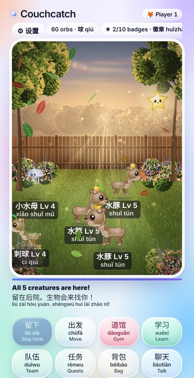
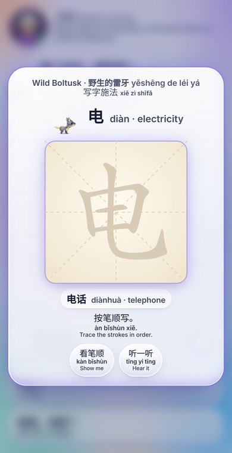
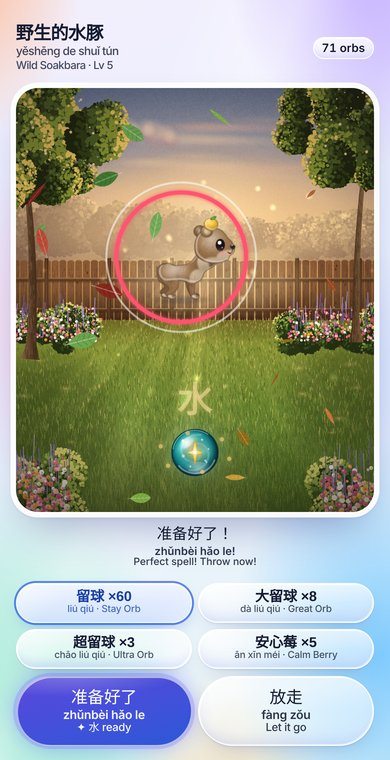
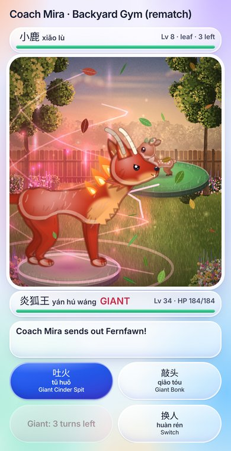
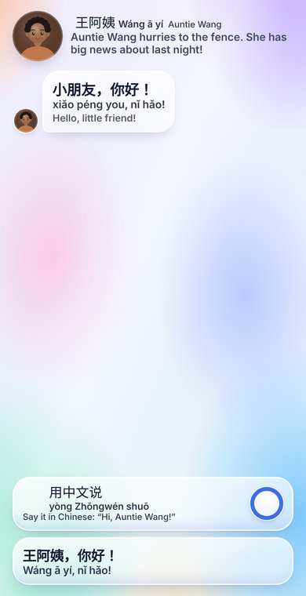
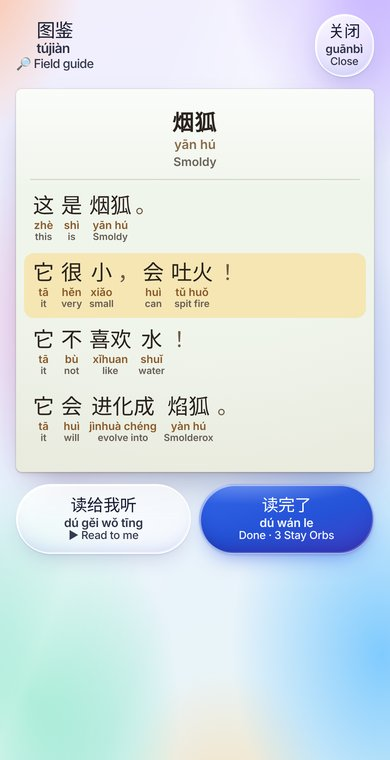
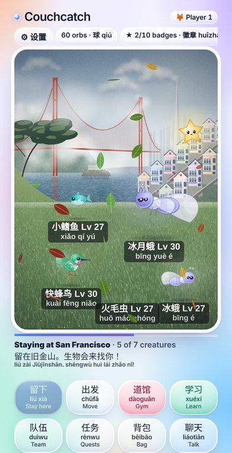
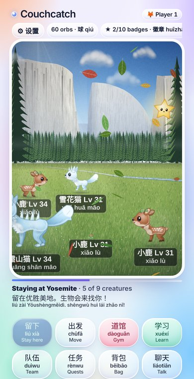
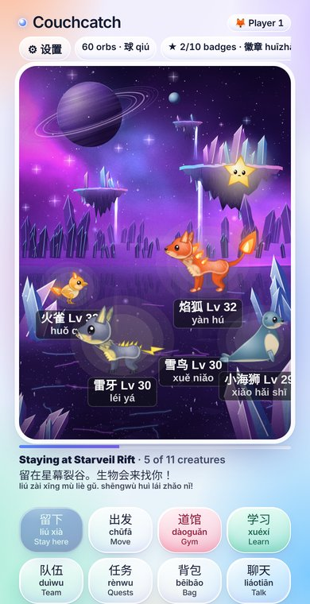
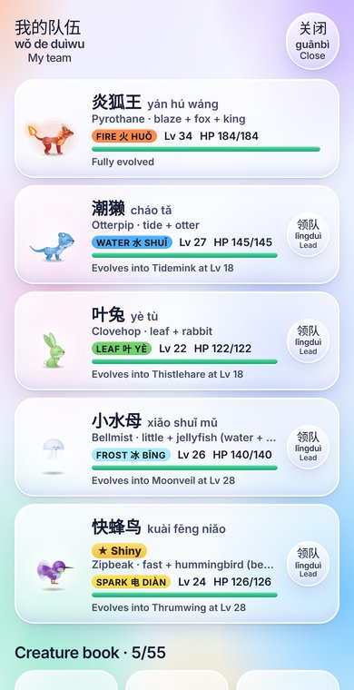

# Couchcatch

Couchcatch is a stay-at-home creature-collecting browser game whose real purpose is helping kids hear and speak everyday Mandarin. You stay in one place and original creatures come to you; moving to a new place draws more of them. Catching and battling stay uninterrupted, and the Chinese practice happens in conversations (gym leaders, a kids' TV host after each badge, airport check-in, California errands, visitors and phone calls) and in a short Pimsleur-style Speak lesson.

All creatures, names, art and text are original.

## Screenshots

<table><tr><td align="center" width="20%"><br><sub>Staying in the backyard: creatures come to you (Little Star floats top right)</sub></td><td align="center" width="20%"><br><sub>Tap a creature: trace a character to cast the catch spell</sub></td><td align="center" width="20%"><br><sub>The spell charges the orb; flick to throw</sub></td><td align="center" width="20%"><br><sub>A gym battle: going Giant</sub></td><td align="center" width="20%"><br><sub>Conversations: hear the line, say it out loud in Chinese, tap what you said</sub></td></tr><tr><td align="center" width="20%"><br><sub>Papers lying around open as a narrated graded reader</sub></td><td align="center" width="20%"><br><sub>San Francisco</sub></td><td align="center" width="20%"><br><sub>Yosemite</sub></td><td align="center" width="20%"><br><sub>The Starveil Rift</sub></td><td align="center" width="20%"><br><sub>Your team</sub></td></tr></table>

## Play

Open `dist/couchcatch.html` in a browser. It is one self-contained file (about 12 MB, including about 1,000 recorded Mandarin clips and stroke data for 1,079 characters).

## Features

- 55 original creatures in evolution lines, drawn procedurally on canvas, with Chinese names and pinyin.
- Places: a home region (Backyard, Lakeshore, Old Quarry, Pine Ridge, Storm Pier, Ash Hills), California (San Diego, Los Angeles, San Francisco, Yosemite) and the Starveil Rift, each with a painted background.
- Flick-to-throw catching with a shrinking ring, curveballs, Great and Ultra orbs and Calm Berries.
- Gym battles with type matchups and a three-turn giant form; giant raid bosses; shiny and legendary creatures.
- Daily quests, catch streaks, evolutions, auto-save to browser storage (and to the Claude artifact database when available). Settings has a save code to move progress between devices or accounts.
- A light glass UI theme (`src/theme_glass.css`).
- Chinese first: Chinese and pinyin on every label, three levels (Beginner shows English, Intermediate hides it until tapped, Advanced also hides pinyin), 220+ recorded Mandarin clips.
- Speak lesson: everyday whole phrases (我要水, 我饿了, 我喜欢猫, 我们一起玩吧, …) built up from the end, then recalled at growing intervals ("How do you say …?" → pause → native audio).
- Conversations: the child hears an English cue, says the line out loud, then taps what she said (only correct lines are offered). A Talk button calls Grandma, Grandpa, Mom, a best friend or a neighbour on demand, and every gym visit starts with a chat with the leader.
- Character tracing (Hanzi Writer): each move, going Giant and the catch spell (cast automatically at the start of each catch and after each break-free) ask the child to trace a character from a ladder that matches the creature's type (fire: 火 → 光 → 红 → 灯 → 热 → 烧), each shown with an example word. After the hand-picked ladders, the progression continues through every HSK 1–4 character, alternating type-themed and general characters, simplest first; tapping a creature opens its catch spell before the catch screen. New characters get a stroke-order demo; learned ones come back for review. A perfect catch spell makes the creature easier to catch and stops it fleeing.
- Things to read: letters, notes, field-guide pages, newspaper and magazine pages lie around while you stay. Each opens as a graded reader (characters, pinyin under them, English under that), is narrated sentence by sentence, and gives items the first time.

## Build

The source files live in `src/`. `game.html` is the template; `build.py` inlines the data, drawing, audio and module files into one page:

```
cd src
python3 build.py draw.js ../dist/couchcatch.html
```

Full check (build, standard screenshots of every screen at 360x629, e2e tests): `npm install && npx playwright install chromium`, then `npm run check`. The contact sheet lands in `/tmp/couchcatch-shots/sheet.png`.

See `CLAUDE.md` for the module map and the design rules the family asked for.

## Audio

Recorded clips: Qwen3-TTS (0.6B CustomVoice) run locally; lines without a whole-sentence clip use the device's Chinese voice when the browser has one.


`tools/make_audio.py` records any Chinese strings that do not yet have a clip in `src/zh_audio.js`, using sherpa-onnx with the `matcha-icefall-zh-baker` Mandarin model (downloaded from the sherpa-onnx GitHub releases). That voice was trained on a dataset licensed for non-commercial use only.

## Files

| File | Contents |
|---|---|
| `src/game.html` | Game logic, UI and styles (template) |
| `src/species.js`, `src/draw.js` | Creature data and the canvas creature renderer |
| `src/scenery_home.js`, `src/scenery_ca.js` | Painted backgrounds for each place |
| `src/fx.js` | Visual effects and item icons |
| `src/sfx.js` | Synthesized sound effects |
| `src/zh_names.js`, `src/vocab.js`, `src/phrases.js` | Chinese names, beginner words and the phrasebook |
| `src/speak.js` | Audio playback, Speak lesson and conversation player |
| `src/trace.js`, `src/hanzi_writer.js` | Character-tracing ladders and overlay; Hanzi Writer library plus stroke data |
| `src/reader.js`, `src/readings.js` | Papers lying around in the scene and the graded-reader sheet; 36 beginner texts |
| `src/story.js`, `src/story_dialogues.js`, `src/story_readings.js` | The Little Star story arc: chapter triggers, goals, the floating companion; its nine conversations and six papers |
| `src/hsk_chars.js`, `tools/make_hsk.py` | All 1,071 HSK 1–4 characters with kid-friendly glosses, example words and themes, and the script that builds them |
| `tools/build_and_check.sh` | Build, syntax-check, standard screenshots and (with `--tests`) the e2e suite in one step |
| `src/orb.js` | Glass orb renderer for the catch screen and item icons |
| `tests/` | Playwright end-to-end tests: `node tests/run.js dist/couchcatch.html` |
| `tools/shots.js`, `tools/compose_shots.py` | Standard screenshots of every screen at 360x629 and a contact sheet |
| `src/zh_audio.js` | Recorded Mandarin clips (base64 MP3) |

## Licenses of bundled third-party parts

- Hanzi Writer 3.5.0 by David Chanin, MIT License (https://github.com/chanind/hanzi-writer).
- Character stroke data from hanzi-writer-data 2.0.1, derived from Make Me a Hanzi (https://github.com/skishore/makemeahanzi), which is covered by the Arphic Public License because it is derived from Arphic's fonts.
